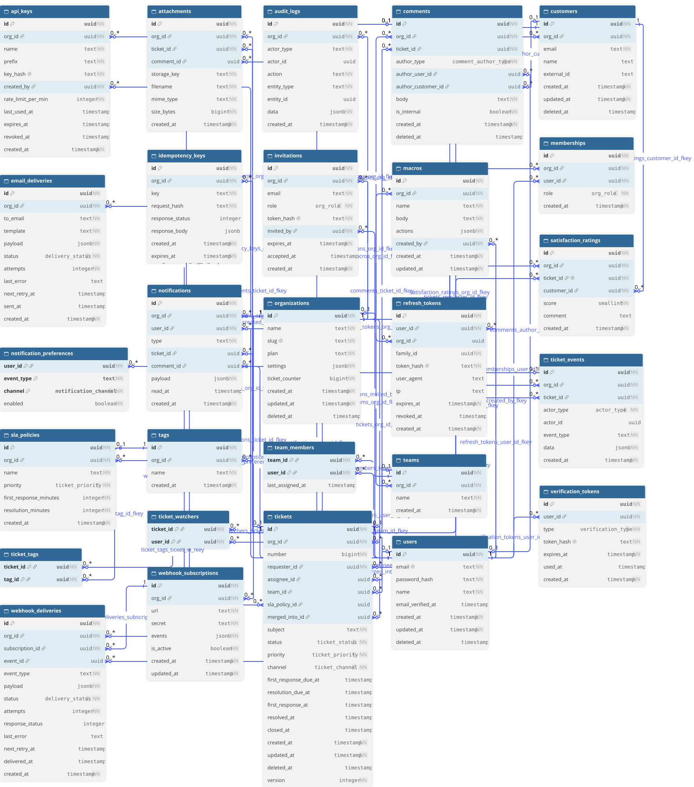

# Gregport

[](https://github.com/HenriNorman/gregport/actions/workflows/ci.yml)

A multi-tenant support ticketing SaaS built with Go and PostgreSQL. It supports organizations, users, memberships, tickets, comments, SLA policies, notifications, and webhooks.

---

## Project Status

| Area | Status |
|:--|:--|
| Authentication | Complete — signup, login, refresh, logout, `/v1/me` |
| JWT and refresh tokens | Complete and tested — refresh rotation, hashing, and reuse detection |
| Tickets | Complete — CRUD, comments, state machine, keyset pagination, optimistic concurrency |
| Teams | Complete — CRUD and membership management |
| Ticket assignment | Complete — manual (assignee or team) and round-robin (`auto: true`) |
| Tags | Complete — create, list, attach, detach (idempotent) |
| Watchers | Complete — add/remove (idempotent); assignee and agent commenters auto-watch |
| Timeline | Complete — cursor-paginated `ticket_events`, oldest first |
| Merge | Complete — source closed and pointed at target; merged tickets read-only |
| Macros | Complete — CRUD (admin/owner) and apply to a ticket (any member) |
| Invitations | Complete — create (admin/owner, grant table), list pending, revoke, accept (new and existing user) |
| Members | Complete — list (any member), role change and removal (admin/owner), last-owner protection |
| Organization settings | Complete — read (any member) and partial update (admin/owner), timezone/priority/support-email validation |
| SLA policies | Complete — CRUD per org, one policy per priority, reference-safe deletion |
| API keys | Complete — create, list, revoke; `gp_live_` keys authenticate as agent-level principals |
| Audit log | Complete — every state-changing action in feat 5 writes an `audit_logs` row in the same transaction |
| Structured logging | Complete — JSON to stdout; one line per request with request ID, route pattern, status, duration and principal IDs |
| Error envelope | Complete — one `{"error":{...}}` shape with `code`, `message`, `details` and `request_id` |
| Production basics | Complete — logging, error envelope, timeouts, health checks, graceful shutdown, config validation, multi-stage image, compose stack, CI and twelve-factor summary |
| SLA, notifications, webhooks | SLA policies exposed; notifications and webhooks schema defined, not exposed |

### Authentication

The authentication implementation includes:

- JWT access tokens.
- Hashed refresh tokens.
- Refresh-token rotation.
- Refresh-token reuse detection.
- Token-family revocation.
- Login, refresh, and logout services.

Every authenticated request carries a verified `user_id`, `org_id`, and `role` in its request context.

### Tickets

The ticket domain is implemented and tested.

- **Create:** Single transaction covering the counter, customer, ticket, comment, and event.
- **List:** Keyset pagination.
- **Get and update:** Optimistic concurrency using `If-Match` and the ticket's `version`.
- **Delete:** Soft deletion, restricted to admins and owners.
- **Comments:** Implemented and exposed.
- **State transitions:** Table-driven state machine.

Tenant isolation is tested across ticket endpoints. Requests for tickets belonging to another organization return `404`, preventing the API from revealing their existence.

The ticket domain's test suite covers CRUD, concurrency, tenant isolation, and every sub-resource (tags, watchers, timeline, merge, macros). Run `go test ./internal/tickets/ -v` for the current count.

### Teams and Assignment

Teams support creation, listing, updating, and deletion, along with adding and removing members (admin/owner only).

Ticket assignment supports manual assignment to an individual agent or a team, and round-robin (`auto: true`) within a team.

Round-robin picks the team member with the oldest `last_assigned_at` inside the same transaction, with `SKIP LOCKED` so concurrent assigns do not pick the same agent.

### Organization Settings

`GET /v1/organization/settings` is available to every authenticated member.
`PATCH /v1/organization/settings` requires `owner` or `admin`.

Settings live in the `organizations.settings` JSONB column and are exposed as a
typed document:

```json
{"settings":{"timezone":"UTC","default_priority":"normal","support_email":""},"updated_at":"2026-11-04T10:00:00Z"}
```

- Updates are partial: omitted fields keep their stored value.
- Missing values read back as `UTC` and `normal`.
- The timezone must be a valid IANA name; the IANA database is embedded in the
  binary so validation also works in the minimal Alpine image.
- The support email must be a bare address and is lowercased. Send an empty
  string to clear it.
- Settings reads and writes are always scoped to the caller's org; another
  tenant's settings are never reachable.

### SLA Policies

The SLA policy endpoints expose the `sla_policies` table:

| Method | Path | Access |
|:--|:--|:--|
| `GET` | `/v1/sla-policies` | any member |
| `GET` | `/v1/sla-policies/{id}` | any member |
| `POST` | `/v1/sla-policies` | owner or admin |
| `PATCH` | `/v1/sla-policies/{id}` | owner or admin |
| `DELETE` | `/v1/sla-policies/{id}` | owner or admin |

- An org may have at most one policy per priority; a duplicate returns `409`
  with code `sla_policy_exists`.
- Names are trimmed and limited to 100 characters.
- First-response and resolution minutes must be positive, at most one year,
  and resolution cannot be shorter than first response.
- Deletion is blocked with `409 sla_policy_in_use` while a ticket still
  references the policy, so due-date history is never orphaned.
- Every read and write is scoped to the caller's org; another tenant's policy
  returns `404`.

---

## Tech Stack

| Component | Technology |
|:--|:--|
| Language | Go 1.27 |
| Router | [chi](https://github.com/go-chi/chi) |
| Database | PostgreSQL 16 |
| Database environment | Docker Compose |
| Container image | Multi-stage Docker build on Alpine |
| PostgreSQL driver | [pgx/v5](https://github.com/jackc/pgx) |
| Authentication | bcrypt, [golang-jwt/jwt/v5](https://github.com/golang-jwt/jwt) |
| IDs | [google/uuid](https://github.com/google/uuid) |
| Env loading | [godotenv](https://github.com/joho/godotenv) |

---

## Architecture

Gregport follows a layered architecture. Each feature lives in its own package under `internal/`, containing its models, repository, service, and handler.

The dependency direction is:

```text
handler → service → repository → database
```

Each layer has a defined responsibility:

- **Handler:** Handles HTTP requests, JSON decoding, and responses.
- **Service:** Contains business logic and remains independent of HTTP and SQL.
- **Repository:** Handles database queries and persistence.
- **Database:** Provides shared database infrastructure, connection pooling, and transactions.

The service layer depends on repository interfaces rather than concrete implementations. This allows tests to inject fake repositories without requiring a database.

### Project Structure

<details>
<summary><code>.github/workflows/</code> — continuous integration</summary>

- `ci.yml` — PostgreSQL-backed tests, compose validation, image build, and container smoke test.

</details>

<details>
<summary><code>Dockerfile</code> and <code>docker-compose.yml</code> — container build and local stack</summary>

- `Dockerfile` — multi-stage build producing a non-root Alpine runtime image.
- `docker-compose.yml` — PostgreSQL, Redis, and API, with health checks and migrations.
- `.dockerignore` — keeps VCS metadata, secrets and docs out of the build context.

</details>

<details>
<summary><code>cmd/api/</code> — application entry point</summary>

- `main.go` — application initialization and entry point.

</details>

<details>
<summary><code>internal/auth/</code> — authentication and tokens</summary>

- `models.go`
- `repo.go`
- `service.go`
- `handler.go`
- `errors.go`
- `tokens.go`
- `repository_tokens_test.go`

</details>

<details>
<summary><code>internal/organizations/</code> — organization settings</summary>

- `models.go` — typed settings document, partial update request, and errors.
- `repository.go` — JSONB read/write against `organizations.settings`.
- `service.go` — defaults, merging, normalisation, and validation.
- `handler.go` — `GET` and `PATCH /v1/organization/settings`.

</details>

<details>
<summary><code>internal/sla/</code> — SLA policies</summary>

- `models.go` — policy entity, request/response DTOs, and errors.
- `repository.go` — org-scoped CRUD and unique/FK error mapping.
- `service.go` — normalisation and validation rules.
- `handler.go` — `/v1/sla-policies` endpoints.

</details>

<details>
<summary><code>internal/tickets/</code> — ticket domain</summary>

- `models.go`
- `repository.go`
- `service.go`
- `handler.go`
- `transitions.go`
- `events.go`
- `pagination.go`
- `policy.go`
- `errors.go`
- `repository_test.go`
- `pagination_test.go`
- `update_test.go`
- `transitions_test.go`
- `tenant_test.go`
- `authz_test.go`
- `rollback_test.go`
- `assignment_test.go`
- `teams_test.go`
- `testhelpers_test.go` — shared test helpers, including `seedMembership`, `freshOrg`, and `dropOrg`.

</details>

<details>
<summary><code>internal/middleware/</code> — HTTP middleware</summary>

- `requestid.go`
- `recovery.go`

</details>

<details>
<summary><code>internal/platform/</code> — shared infrastructure</summary>

- `cache/` — Redis-backed `Cache` interface, tenant-scoped key builders, and an in-memory test double.
- `clientip/` — client-IP resolution with opt-in trusted-proxy handling.
- `config/` — configuration loading from environment variables.
- `database/` — pgx connection pool and transaction management.
- `httpx/` — `DecodeJSON`, `WriteJSON`, `WriteError`, and `APIError`.
- `logging/` — JSON `slog` construction, log-level parsing, and the request-scoped logger in the context.
- `metrics/` — process-local counters for cache, rate-limit, and idempotency outcomes.
- `ratelimit/` — atomic Redis sliding-window limiter and the in-memory login fallback.
- `requestctx/` — authenticated principal stored in request context.

</details>

<details>
<summary><code>migrations/</code> — database migrations</summary>

- SQL schema and migrations.

</details>

<details>
<summary><code>internal/platform/</code> — shared infrastructure</summary>

- `audit/` — `Record(ctx, tx, orgID, principal, action, entityType, entityID, data)` for the append-only audit log.
- `cache/` — Redis-backed `Cache` interface, tenant-scoped key builders, and an in-memory test double.
- `clientip/` — client-IP resolution with opt-in trusted-proxy handling.
- `config/` — configuration loading from environment variables.
- `database/` — pgx connection pool and transaction management.
- `httpx/` — `DecodeJSON`, `WriteJSON`, `WriteError`, and `APIError`.
- `logging/` — JSON `slog` construction, log-level parsing, and the request-scoped logger in the context.
- `requestctx/` — authenticated principal stored in request context, `Kind` (user | api_key) and `ActorID`.

</details>

---

## Database Schema



Migrations live in `migrations/`. The Compose stack applies the `*.up.sql`
files in order when the database volume is first created.

---

## API Reference

<details open>
<summary><b>Interactive docs</b></summary>

- **View spec (Swagger Editor):** [Open `docs/swagger.yaml`](https://editor.swagger.io/?url=https://raw.githubusercontent.com/HenriNorman/gregport/main/docs/swagger.yaml)

</details>

The OpenAPI spec lives at [`docs/swagger.yaml`](./docs/swagger.yaml).

---

## Getting Started

### Prerequisites

- Go 1.27
- Docker and Docker Compose
- PostgreSQL 16 (provided through Docker Compose)

### Installation

Clone the repository and enter the project directory.

Copy the example environment file:

```bash
cp .env.example .env
```

Configure the required environment variables, especially `DB_PASSWORD` and `JWT_SECRET`.

#### Full Stack with Compose

```bash
docker compose up --build -d --wait
```

This builds the API image, starts PostgreSQL, applies the migrations on the
first database initialization, and waits for both health checks. The API is
available at `http://localhost:8080`.

```bash
docker compose logs -f api
curl localhost:8080/healthz
```

Stop the stack with `docker compose down`. To delete the database volume and
re-apply migrations from scratch:

```bash
docker compose down -v
```

#### Local Go Process

Start only PostgreSQL:

```bash
docker compose up -d db --wait
```

Then run the API on the host:

```bash
go run ./cmd/api
```

The API listens on port `8080` by default. You can override this using `APP_PORT`.

### Health Checks

Liveness and readiness are separate so a database outage does not restart the
process.

```bash
curl localhost:8080/healthz
curl localhost:8080/readyz
```

`/healthz` is a liveness probe. It returns `200` with `{"status":"ok"}` when
the process can serve HTTP. It does not touch PostgreSQL.

`/readyz` is a readiness probe. It pings PostgreSQL with a two-second deadline:

```json
{"status":"ok"}
```

A `200` means the API can serve requests. If the ping fails, it returns `503`:

```json
{"status":"unready"}
```

The database error is logged at `WARN` with the request ID but never returned
to the caller.

### Container Image

Build the production image:

```bash
docker build -t gregport-api .
```

The build has two stages:

- `golang:1.27.2-alpine` compiles a static Linux binary with `CGO_ENABLED=0`,
  `-trimpath`, and stripped symbols.
- `alpine:3.24` contains only that binary and runs it as the non-root `app`
  user (UID 10001).

The container listens on `8080`, logs JSON to stdout, and handles `SIGTERM` so
graceful shutdown works. Set `APP_PORT` to change the port. When running the
container, point `DB_HOST` at a PostgreSQL instance reachable from inside the
container; `localhost` refers to the container itself.

### Docker Compose Stack

`docker compose up --build -d --wait` starts three services on the `gregport`
network:

| Service | Purpose |
|:--|:--|
| `db` | `postgres:16-alpine` with a named `pgdata` volume and a `pg_isready` health check. |
| `redis` | `redis:7-alpine` with a `redis-cli ping` health check. Cache and limiter state are intentionally not persisted. |
| `api` | Built from the local `Dockerfile`; waits for `db` and `redis` to be healthy and reads its environment from `.env`. |

- PostgreSQL publishes `${DB_PORT:-5432}` on the host; the API connects
  internally on `db:5432`, regardless of the host port.
- Redis publishes `${REDIS_PORT:-6379}` on the host; the API connects
  internally on `redis:6379`.
- The `*.up.sql` migrations are mounted read-only into
  `/docker-entrypoint-initdb.d` and run once when the volume is first created.
  Use `docker compose down -v` to reset the database.
- The API publishes `${APP_PORT:-8080}` and is health-checked through
  `/healthz`.
- `stop_grace_period` is `20s`, above the default `SHUTDOWN_TIMEOUT` of `15s`,
  so Docker waits for graceful shutdown instead of killing the process early.
- Compose refuses to start if `DB_PASSWORD` or `JWT_SECRET` is missing.

---

## Configuration

The application reads its configuration from environment variables.

| Variable | Required | Default | Notes |
|:--|:--:|:--|:--|
| `DB_HOST` | No | `localhost` | PostgreSQL host |
| `DB_PORT` | No | `5432` | PostgreSQL port |
| `DB_USER` | No | `postgres` | Database user |
| `DB_PASSWORD` | Yes | — | Database password |
| `DB_NAME` | No | `gregport` | Database name |
| `APP_PORT` | No | `8080` | HTTP server port |
| `LOG_LEVEL` | No | `info` | `debug`, `info`, `warn`, or `error` |
| `JWT_SECRET` | Yes | — | Minimum 32 bytes |
| `ACCESS_TOKEN_TTL` | No | `15m` | Go duration |
| `REFRESH_TOKEN_TTL` | No | `720h` | Go duration (30 days) |
| `SERVER_READ_HEADER_TIMEOUT` | No | `5s` | Go duration |
| `SERVER_READ_TIMEOUT` | No | `15s` | Go duration |
| `SERVER_WRITE_TIMEOUT` | No | `30s` | Go duration |
| `SERVER_IDLE_TIMEOUT` | No | `60s` | Go duration |
| `REQUEST_TIMEOUT` | No | `10s` | Go duration; keep below `SERVER_WRITE_TIMEOUT` |
| `SHUTDOWN_TIMEOUT` | No | `15s` | Go duration; keep above `REQUEST_TIMEOUT` |
| `REDIS_ADDR` | No | `localhost:6379` | Redis host and port |
| `REDIS_PASSWORD` | No | — | Redis password |
| `REDIS_DB` | No | `0` | Redis logical database |
| `REDIS_DIAL_TIMEOUT` | No | `1s` | Go duration |
| `REDIS_READ_TIMEOUT` | No | `500ms` | Go duration |
| `REDIS_WRITE_TIMEOUT` | No | `500ms` | Go duration |
| `CACHE_TIMEOUT` | No | `200ms` | Per-operation cache deadline |
| `CACHE_TTL_SETTINGS` | No | `5m` | Org settings cache TTL |
| `CACHE_TTL_SLA_POLICIES` | No | `5m` | SLA policy cache TTL |
| `CACHE_TTL_DASHBOARD_COUNTS` | No | `45s` | Dashboard counts cache TTL |
| `RATE_LIMIT_REQUESTS` | No | `100` | Authenticated requests per window |
| `RATE_LIMIT_WINDOW` | No | `1m` | Authenticated rate-limit window |
| `PUBLIC_RATE_LIMIT_REQUESTS` | No | `30` | Unauthenticated requests per window |
| `PUBLIC_RATE_LIMIT_WINDOW` | No | `1m` | Unauthenticated rate-limit window |
| `LOGIN_RATE_LIMIT_REQUESTS` | No | `5` | Login attempts per window |
| `LOGIN_RATE_LIMIT_WINDOW` | No | `15m` | Login rate-limit window |
| `TRUST_PROXY_HEADERS` | No | `false` | Honour `X-Forwarded-For` only when explicitly enabled |
| `TRUSTED_PROXY_CIDRS` | No | — | Comma-separated trusted proxy CIDRs |
| `IDEMPOTENCY_TTL` | No | `24h` | How long an idempotency key is retained |

Configuration is validated at startup, before the database is opened. Missing
or invalid values make the process exit non-zero, and every problem found is
reported together. In particular:

- `DB_PASSWORD` is required and has no default.
- `JWT_SECRET` must be at least 32 bytes.
- `LOG_LEVEL` must be `debug`, `info`, `warn`, or `error`.
- Ports must be between `1` and `65535`.
- Durations must be positive; `REQUEST_TIMEOUT=0` disables the deadline.
- `REQUEST_TIMEOUT` must be below `SERVER_WRITE_TIMEOUT`.
- `SHUTDOWN_TIMEOUT` must be at least `REQUEST_TIMEOUT`.
- Redis timeouts and cache TTLs must be positive; `REDIS_DB` must be zero or greater.
- Rate-limit request counts must be at least one; windows must be positive.
- `TRUST_PROXY_HEADERS=true` requires at least one valid `TRUSTED_PROXY_CIDRS` entry.
- `IDEMPOTENCY_TTL` must be positive.
- The database DSN is built with `url.URL`, so characters such as `@`, `:`,
  `/`, `?`, `#` and `%` in credentials are escaped automatically.

Generate a secure JWT secret using:

```bash
openssl rand -base64 32
```

`JWT_SECRET` has no default. The application terminates at startup if it is missing or invalid.

Never commit the secret, log it, or reuse it across projects.

---

## Caching

`internal/platform/cache` exposes a small `Get`/`Set`/`Delete` interface and a
single Redis implementation. Services depend on the interface, so tests use
the in-memory `Memory` implementation without a Redis process.

Every cache key for tenant data uses one scheme and always contains the org id:

```text
org:{orgID}:settings
org:{orgID}:sla_policies
org:{orgID}:sla_policy:{policyID}
org:{orgID}:dashboard:counts
org:{orgID}:apikey:{apiKeyID}:last_used
```

Authenticated rate-limit buckets also include the org id. The only keys without
a tenant are the pre-authentication public-IP and login buckets, because no
tenant is known yet.

The key builders return an error when the org id is missing. A test enumerates
every builder and fails if the org id is absent or two keys collide.

### Redis Failure Policy

Redis is an optimization and a protection layer, not the source of truth.
Behaviour is chosen per path, not globally:

| Path | Redis unavailable | Reason |
|:--|:--|:--|
| General API rate limits | Fail open, log, and count | A cache outage must not become an API outage. |
| Login rate limit | Fall back to a stricter in-memory limiter | Credential stuffing should not be made easier by an outage. |
| Read-through cache | Bypass Redis and read PostgreSQL | Correctness wins; the request still completes. |
| Idempotency | Unaffected | Records live in PostgreSQL. |
| `/readyz` | Report `503` | Readiness exposes the degraded dependency. |

A readiness failure is intentional even though fail-open requests may still
succeed. Deployment tooling should treat it as a signal, not as proof that the
process cannot serve traffic.

---

## Rate Limiting

The limiter is a Redis sorted-set sliding window evaluated by one Lua script.
Removing expired entries, counting the window, and recording the current
request happen atomically on the Redis server, so concurrent requests cannot
both slip past the boundary. Redis `TIME` is used instead of the application
clock.

| Scope | Default | Window | Key |
|:--|:--|:--|:--|
| Authenticated user | 100 | 1 minute | `org:{orgID}:ratelimit:user:{userID}` |
| API key | 100 | 1 minute | `org:{orgID}:ratelimit:apikey:{keyID}` |
| Public IP | 30 | 1 minute | `ratelimit:ip:{ip}` |
| Login | 5 | 15 minutes | `ratelimit:login:{ip}:{emailHash}` |

The login bucket uses a SHA-256 hash of the normalised email, never the raw
address. When Redis is unavailable, login falls back to the in-memory
fixed-window limiter with half the configured limit; the general API fails
open. Fallback responses carry `X-RateLimit-Degraded: 1`.

Every limited response carries:

| Header | Meaning |
|:--|:--|
| `X-RateLimit-Limit` | Requests allowed in the current window |
| `X-RateLimit-Remaining` | Requests left after this one |
| `X-RateLimit-Reset` | Window reset time as a Unix timestamp |
| `Retry-After` | Seconds to wait; present on `429` only |

A rejected request returns the standard error envelope with code
`rate_limited` and status `429`.

The login limiter runs before the handler, buffers the request body, and
restores it. The public IP limiter covers signup, refresh, logout, and
invitation acceptance. `X-Forwarded-For` is ignored unless
`TRUST_PROXY_HEADERS=true` and the immediate peer matches
`TRUSTED_PROXY_CIDRS`.

---

## API Design and Rules

### Error Responses

Every failure uses one envelope:

```json
{"error":{"code":"ticket_not_found","message":"ticket not found","details":[],"request_id":"0f9b…"}}
```

- `code` is stable and machine-readable; `message` is safe to show to a user.
- `details` is always an array. Field-level validation errors populate it.
- `request_id` matches the `X-Request-ID` response header and the access-log
  line for the same request.
- Domain errors are `*httpx.APIError` sentinels, so each carries its own HTTP
  status, code and public message. `errors.Is` still works through wrapping.
- Unknown errors return `500` with `code: "internal"` and a generic message.
  The real error is logged at `ERROR` with the request ID and never sent to
  the client.
- JSON decoding failures return safe codes (`invalid_json`, `unknown_field`,
  `payload_too_large`) instead of raw decoder text.
- Panics are recovered, logged with their stack, and returned in the same
  envelope.

### Tenant Isolation

Tickets use per-organization numbers rather than UUIDs in their URLs.

The lookup key is `(org_id, number)`. A ticket belonging to another organization returns `404`, never `403`.

This prevents the API from confirming whether a resource exists in another tenant.

- **Authorization gates on `Kind` before role.** Every management gate in
  `policy.go` returns `false` for a principal whose `Kind` is not `user`,
  before checking the role. API keys are always `agent`-level and never
  manage teams, members, API keys, or webhooks. The grant table — who may
  invite whom — is a unit test: owner → admin/agent, admin → agent, nobody
  → owner.

- **Invitation tokens work like refresh tokens.** 32 random bytes from
  `crypto/rand`, base64url-encoded, returned **once** in the create
  response and never again — list responses never carry the token. Only the
  SHA-256 hash is stored in `invitations.token_hash`. Expiry is 7 days;
  single use is enforced by `accepted_at` under `FOR UPDATE`, so two
  simultaneous accepts of the same token can't both succeed.
- **Who can invite whom is a grant table, tested.** Owner → admin/agent.
  Admin → agent. Nobody → owner. API keys → nobody. Enforced by
  `CanInvite(principal, targetRole)`.
- **Accepting an invitation has two paths.** No principal on the request →
  new user: the body carries `name` and `password`, the user and membership
  are created in one transaction. A principal on the request → existing
  user: `name`/`password` are ignored, the principal's email must match the
  invitation's email (403 otherwise), and only the membership is created.
  A duplicate membership returns 409.

- **Member role changes reuse the invitation grant table.** `PATCH
  /v1/members/{userId}` calls `CanInvite(principal, newRole)` — owner may set
  admin or agent, admin may set agent only, nobody sets owner. A role change
  writes a `member.role_changed` audit row.
- **An org always keeps one owner.** `UpdateMemberRole` and `RemoveMember`
  lock the target membership `FOR UPDATE`, then lock every owner row in the
  org (`SELECT 1 FROM memberships WHERE role = 'owner' FOR UPDATE`), count
  them in Go, and refuse to demote or remove the last one (422). Two
  concurrent removals of two owners serialize on the owner-row locks: the
  first succeeds, the second sees one owner left and refuses. The invariant
  holds under concurrency, not just sequentially.
- **Removing a member revokes their refresh tokens for this org.**
  `DELETE /v1/members/{userId}` deletes the membership and runs `UPDATE
  refresh_tokens SET revoked_at = now() WHERE user_id = $1 AND org_id = $2`
  in the same transaction. The removed user's access token stays valid up to
  15 minutes (it's stateless), but their refresh token is dead immediately —
  they cannot get a new one. A `member.removed` audit row is written.
- **API keys are `gp_live_<id>_<secret>` and never stored raw.**
  `POST /v1/api-keys` generates 8 random bytes for the id and 32 for the
  secret, both base64url. The full key is returned once; the DB stores the
  prefix `gp_live_<id>` and the SHA-256 of the **full** key. Lookup is by
  prefix, then `subtle.ConstantTimeCompare` on the hash. List responses
  carry the prefix only.
- **Revoking a key sets `revoked_at`, it does not delete the row.** A
  revoked key returns 401 on every request — indistinguishable from an
  expired or unknown key to the client, but distinguishable in the DB, so
  "revoked" and "never existed" are not conflated.
- **API key mutations are owner/admin.** `CanManageAPIKeys` gates
  `POST/GET/DELETE /v1/api-keys`; the `RequireRole` middleware gates the
  routes. Keys themselves (the principals they authenticate) are never
  allowed to create, list, or revoke keys — see the policy rule.

- **`Authenticate` branches on the token prefix.** A bearer token starting
  with `gp_live_` takes the API-key path: parse the prefix, look up the row,
  reject revoked/expired, compare the SHA-256 of the full key with
  `subtle.ConstantTimeCompare`. Anything else takes the JWT path. Both paths
  produce a `Principal`; `Kind` distinguishes them.
- **`last_used_at` is throttled in memory.** Each key's last write is tracked
  in a `sync.Mutex`-guarded map; a write fires at most once per minute, in a
  background goroutine. A burst of requests from one key does not hammer the
  database. (Redis will replace the in-memory map in a later feat.)
- **API keys are agent-level and limited to tickets and comments.** They
  pass every ticket operation (create, list, get, update, comment, assign,
  tag, watch, merge, macro) and fail every management gate — members, teams,
  API keys, webhooks — because `policy.go` checks `Kind` before role.

- **Audit rows commit atomically with the mutation they describe.**
  `invitation.created`, `invitation.accepted`, `member.role_changed`,
  `member.removed`, `api_key.created`, and `api_key.revoked` each write an
  `audit_logs` row inside the same transaction as the change, via
  `audit.Record(ctx, tx, ...)`. The mutation methods that participate expose
  a `*Tx` variant that takes the caller's transaction; the service opens one
  transaction, calls the mutation and the audit, and commits once. A crash
  between the two cannot leave a mutation without its audit row.


### Optimistic Concurrency

Ticket updates require an `If-Match` header.

| Condition | HTTP Status |
|:--|:--|
| Missing `If-Match` header | `428 Precondition Required` |
| Stale ticket version | `412 Precondition Failed` |

Every successful ticket update increments its `version`.

This prevents two agents from silently overwriting each other's changes.

### Ticket Assignment

Assignment is validated within the same transaction as the ticket update.

- The assignee must have an organization membership with the `owner`, `admin`, or `agent` role.
- Team assignment verifies that the team belongs to the caller's organization.
- Client-provided user IDs are never trusted without membership verification.

Assignment also produces a `ticket.assigned` event containing the old and new assignee/team information.

The new assignee is automatically added to `ticket_watchers`. The insertion uses `ON CONFLICT DO NOTHING`, making repeated assignments idempotent.

### Round-robin Assignment

`auto: true` with a `team_id` picks the team member with the oldest `last_assigned_at`.

The pick runs inside the same transaction as the ticket update, with `FOR UPDATE OF team_members SKIP LOCKED` so concurrent auto-assigns to the same team do not both choose the same agent.

The join on `memberships` excludes agents removed from the org. A team with no assignable members returns `422`.

### Tags

- **Tags are lowercase and unique per org.** `POST /v1/tags` normalizes the name (trim, lowercase) before insert; a duplicate in the same org returns `409`. Attach and detach take the tag **name** in the URL, not the UUID, and normalize it the same way before the lookup.
- **Tag attach and detach are idempotent.** `ON CONFLICT DO NOTHING` on attach, `DELETE` returning zero rows on detach — both return `204` with no error. `ticket.tagged` and `ticket.untagged` fire only on an actual change; a no-op writes no event.

### Watchers

- Watcher addition and removal are idempotent.
- The ticket assignee is automatically added as a watcher.
- Agents who comment on a ticket are automatically added as watchers.

### Timeline

- **The ticket timeline is append-only and cursor-paginated oldest-first.** `GET /v1/tickets/{number}/events` reads `ticket_events` joined to the ticket by `(org_id, number)`. Order is `created_at ASC, id ASC` — a timeline reads chronologically, unlike the ticket list. Cursor is opaque, limit defaults to 50 and caps at 100. No code path issues `UPDATE` or `DELETE` on `ticket_events`; the table is an append-only log.
- **Event types and their `data` shapes.** The client switches on `event_type`; each type carries a different JSON object in `data`:

**Audit:**

- The audit helper inserts a row inside a caller's transaction with the
  correct actor type, actor id, action, and entity.

| `event_type` | `data` fields |
|---|---|
| `ticket.created` | `number`, `subject`, `priority` |
| `ticket.status_changed` | `old`, `new` |
| `ticket.assigned` | `old_assignee_id`, `new_assignee_id`, `old_team_id`, `new_team_id`, `auto` (round-robin only) |
| `ticket.tagged` | `tag` |
| `ticket.untagged` | `tag` |
| `comment.added` | `comment_id`, `is_internal` |
| `ticket.deleted` | — |

### Merge

- **Merge closes the source and points it at the target.** `POST /v1/tickets/{number}/merge` with `{into_number}` runs one transaction that locks both rows by id ascending (`FOR UPDATE`, deadlock-safe), checks the rules (same org, different tickets, target not closed or already merged, same requester), sets `source.merged_into_id = target.id`, closes the source, adds a system comment on both tickets, and writes `ticket.merged` on the source. A second concurrent merge of the same pair sees the source already merged and returns `409`.
- **Merged tickets are read-only.** Every mutation — update, assign, comment, delete, tag attach/detach — selects `merged_into_id` under `FOR UPDATE` and returns `409` if it is set. The check is in the repository, next to the lock, so it cannot be bypassed by a caller that skips the service.

### Macros

- **Macros store validated JSON actions and apply through the service.** `macros.body` holds `{"set_status", "set_priority", "add_tags", "comment"}`, validated at create/update (enum values, non-empty tags, 20k comment cap). Applying a macro calls the same service methods as the normal endpoints — `UpdateTicket`, `AttachTag`, `CreateComment` — so the state machine, events, and authorization apply. A macro that sets an illegal transition fails with `422`, exactly like `PATCH /v1/tickets/{number}` would.
- **Macro application is ordered, not atomic.** Actions run in order: status, priority, tags, comment. Status first means an illegal transition fails before anything is written. If a later action fails (e.g. a tag does not exist), earlier actions stay applied. This is deliberate and documented.
- **Macro mutations are admin/owner; GET and apply are any member.** Creating, updating, and deleting a macro require role owner or admin. Listing and applying a macro are open to any org member.

### Pagination

Ticket listing uses keyset pagination.

Pass `?limit=N&cursor=<opaque>` to the endpoint.

| Parameter | Description |
|:--|:--|
| `limit` | Page size. Maximum value: `100`. |
| `cursor` | Opaque continuation token returned by the previous response's `next_cursor`. |
| `next_cursor` | Returned by the server. Its absence indicates the last page. |

The ordering is:

```sql
ORDER BY created_at DESC, id DESC
```

The cursor is opaque and should never be parsed by clients.

---

## Logging

The API writes structured JSON to stdout using `log/slog`, at the level set by
`LOG_LEVEL`. One line is emitted per request and carries the same request ID
returned to the client in `X-Request-ID`:

```json
{"time":"2026-11-03T12:00:00.000Z","level":"INFO","msg":"request","method":"GET","route":"/v1/tickets/{number}","status":200,"duration_ms":3.41,"bytes":418,"request_id":"0f9b…","org_id":"…","user_id":"…"}
```

- `route` is the chi route pattern, never the raw path, so ticket numbers,
  user IDs and query strings do not leak into logs.
- The logger stored in the request context is enriched with `request_id`, so
  service-level log lines carry the same ID as the access line.
- `org_id` and `user_id` are added once a request is authenticated. API-key
  requests log `api_key_id` instead of `user_id`.
- 5xx responses log at `ERROR`; everything else logs at `INFO`.
- Request bodies, query strings, `Authorization` headers, passwords, tokens
  and token hashes are never logged.
- A panic is recovered, logged at `ERROR` with its stack, returned as the
  standard error envelope, and does not stop the server.

---

## Timeouts

The HTTP server is configured with four hard limits:

| Limit | Default | Protects against |
|:--|:--|:--|
| `ReadHeaderTimeout` | `5s` | Slow header writes (Slowloris) |
| `ReadTimeout` | `15s` | Slow request bodies |
| `WriteTimeout` | `30s` | Handlers that ignore cancellation |
| `IdleTimeout` | `60s` | Idle keep-alive connections |

Each request also gets a `REQUEST_TIMEOUT` deadline (default `10s`). When it
expires:

- the request context is cancelled, so PostgreSQL queries and other
  context-aware work stop;
- deadline errors are mapped to `503` with code `request_timeout` in the
  standard error envelope;
- a handler that returns after the deadline without writing a response also
  gets the `503` envelope.

`REQUEST_TIMEOUT` should stay below `SERVER_WRITE_TIMEOUT`. The server write
timeout remains the hard stop for a handler that ignores context cancellation.

---

## Graceful Shutdown

On `SIGTERM` or `SIGINT` the server:

1. stops accepting new connections;
2. waits up to `SHUTDOWN_TIMEOUT` (default `15s`) for in-flight requests;
3. closes the database pool;
4. exits with status `0`.

If the deadline expires, remaining connections are closed and the process
exits non-zero. Keep `SHUTDOWN_TIMEOUT` above `REQUEST_TIMEOUT` so active
requests get a chance to finish cancelling cleanly.

---

## Twelve-Factor Alignment

The table records the current posture. `Partial` marks a deliberate gap that
is listed below it, not a hidden requirement.

| Factor | How Gregport applies it | Status |
|:--|:--|:--:|
| **1. Codebase** | One Git repository. `cmd/api` is the current deployable and `cmd/worker` is a placeholder for future background jobs; there are no copy-pasted services. | Yes |
| **2. Dependencies** | Every Go dependency is pinned in `go.mod`/`go.sum`. The runtime image contains only the compiled binary on Alpine; nothing is installed at runtime. | Yes |
| **3. Config** | All settings come from environment variables. `config.Load` validates them before startup, secrets have no defaults, `.env` is local-only, and Compose injects values at start. | Yes |
| **4. Backing services** | PostgreSQL is attached through `DB_HOST`, `DB_PORT`, `DB_USER`, `DB_PASSWORD` and `DB_NAME`. The DSN is built at runtime, so the database endpoint can change without code changes. | Yes |
| **5. Build, release, run** | A multi-stage `Dockerfile` builds a static binary. The image is the immutable release artifact and configuration is supplied when the container starts. CI builds the image; registry publishing is not automated yet. | Yes |
| **6. Processes** | The API is stateless. Access tokens are JWTs, refresh tokens are stored hashed in PostgreSQL, and no sessions live in process memory. Any replica can serve any request. | Yes |
| **7. Port binding** | The server binds `:APP_PORT` (`8080` by default) and serves HTTP directly. Compose publishes the same port; no external web server is required. | Yes |
| **8. Concurrency** | Scale horizontally by running more API containers. Each process has its own pgx pool and shared work is coordinated through PostgreSQL, with no sticky sessions. | Yes |
| **9. Disposability** | Configuration fails fast, startup is quick, `SIGTERM`/`SIGINT` drain in-flight requests, requests have deadlines, and Compose allows `20s` for shutdown. | Yes |
| **10. Dev/prod parity** | Local Compose and CI use the same image, Go version, `postgres:16-alpine` and migration SQL. A production environment and automated release are not set up yet. | Partial |
| **11. Logs** | JSON goes to stdout with request IDs and route patterns; the process writes no log files. Docker captures the stream, and secrets and raw paths are never logged. | Yes |
| **12. Admin processes** | Migrations are one-off SQL executed by the PostgreSQL init step, and admin queries use `psql`; they do not run inside the API process. A dedicated migration command and durable worker are not implemented. | Partial |

**Remaining gaps**

- No production environment or automated registry/release pipeline yet.
- Migrations run only when the Compose database volume is first initialized;
  there is no standalone migration command for existing databases.
- `cmd/worker` is a placeholder, so there are no background jobs to run as a
  separate process.
- Logs are stdout-only; there is no bundled aggregation or retention layer.

---

## Testing

The project includes integration tests, authentication unit tests, logging and middleware tests, and security-focused token tests.

### Running Tests

Run the authentication package tests:

```bash
go test ./internal/auth/ -v
```

Run the entire test suite:

```bash
go test ./... -race -count=1
```

Ticket tests are integration tests and require PostgreSQL. CI runs the same
command against a fresh, migrated PostgreSQL 16 service.

### Integration Tests

These tests use a real PostgreSQL database.

**Authentication**

- Signup transaction rollback.
- Refresh-token rotation and reuse detection.

**Tickets**

- Concurrent ticket creation: 20 concurrent creates produce ticket numbers `1–20` without gaps or duplicates.
- Failed ticket creation does not leave a gap in per-organization numbering.
- Tenant isolation: every ticket endpoint returns `404` when organization B accesses organization A's ticket.
- Update concurrency: two simultaneous updates result in one successful update and one `412 Precondition Failed`.
- Version mismatch rejection.
- Invalid state transition rejection.
- Valid state transition and event creation.
- Transaction rollback when event creation fails, verified using a forced database trigger.
- Manual assignment to an agent.
- Assignment to a non-member returns `422`.
- Team-only assignment.
- Cross-organization team assignment returns `404`.
- Team creation.
- Duplicate team creation returns `409`.
- Agent team-management attempt returns `403`.
- Adding a cross-organization member returns `422`.
- Tags: create lowercases and trims the name; duplicate per org returns `409`; attach and detach are idempotent (one event per actual change); attaching a nonexistent tag returns `404`; attaching a tag to another org's ticket returns `404`.

**Watchers**
- add is idempotent; adding a non-member returns `422`;
remove is idempotent; removing a watcher from another org's ticket returns `404`;
an agent who comments is auto-added as a watcher.

**Timeline**

- events appear in order (created, assigned, tagged, comment, status);
cursor pagination returns every event exactly once; another org's ticket returns `404`.

**Merge**
- happy path closes the source and writes one `ticket.merged` event;
merge into self returns `422`; merging into another org's ticket returns `404`;
two concurrent merges of the same pair yield exactly one success;
a comment on a merged source returns `409`.

**Macros**
- create validates status/priority enums and rejects unknown fields;
duplicate name returns `409`; applying a macro sets status, attaches tags, 
and adds a comment; an illegal status transition in a macro returns `422` 
(state machine applies); another org's macro returns `404`.

**Audit**

- `member.role_changed` and `member.removed` write audit rows; the
  invitation and API key audit rows are asserted in their own tests. Every
  state-changing action in feat 5 commits its audit row inside the same
  transaction as the mutation, so a crash cannot leave a change unaudited.

**Invitations**

- owner invites agent (201, raw token returned once, token
  hashed in DB, audit row written); admin inviting admin returns 403;
  owner inviting owner returns 403; accept creates a new user + membership
  with an audit row; accept by an existing user with a mismatched email
  returns 403; expired and already-used tokens return 422; a duplicate
  membership returns 409.

**Members**

- any member can list the roster; owner promotes agent to admin;
  admin promoting to admin returns 403 (grant table); granting owner returns
  403; removing the last owner returns 422; two concurrent removals of the
  last two owners leave exactly one owner; removing a member revokes their
  refresh tokens for this org.

**API Key**
- A valid key returns a principal with `Kind: api_key`, the
  key's id as `ActorID`, and role `agent`; revoked, expired, wrong-secret,
  and unknown-prefix keys all return 401; `last_used_at` is written at most
  once per minute per key; an API key can create a ticket and cannot create
  an API key.

### Unit Tests

Authentication unit tests use a fake `Repo` implementation and do not require a database.

- Signup validation and normalization.
- Identical responses for unknown email and incorrect password, using timing-safe dummy bcrypt verification.
- Organization selection:
  - Single organization.
  - Multiple organizations without a slug.
  - Multiple organizations with a slug.
- Refresh-token reuse detection and token-family revocation.
- Unknown tokens do not trigger reuse detection.
- Logout revokes refresh tokens by hash.

The authentication service depends on the `auth.Repo` interface rather than the concrete `*Repository`. Production injects the real repository, while tests inject a fake implementation.

Ticket tests are integration tests and require PostgreSQL.

- **Policy grant table** (`policy_test.go`): every `(caller kind, caller
  role, target role)` triple — owner invites admin/agent, admin invites
  agent, nobody invites owner, API keys cannot invite or manage anything.
  The `Kind` gate is checked before the role in every management function.

### Token Tests

These tests perform real JWT signing and verification without a database.

- Access-token round trip.
- Expiry rejection.
- Tamper detection.
- `alg: none` rejection.
- Wrong-secret rejection.
- Refresh-token uniqueness and hashing.

They verify actual security behavior, including algorithm pinning, required expiration, and tamper detection.

### Logging and Middleware Tests

These tests do not require a database.

- Log level parsing, including rejection of unknown levels, and JSON output
  shape.
- Request IDs are generated when absent, echoed in `X-Request-ID`, and appear
  on every access-log line.
- Access-log fields: method, route pattern, status, duration, bytes, and the
  authenticated principal (`user_id` or `api_key_id`, plus `org_id`).
- Raw paths, query strings, request bodies, `Authorization` headers and known
  secret values never appear in log output.
- 5xx responses log at `ERROR`; unmatched routes log the `unmatched`
  placeholder rather than the requested path.
- Panic recovery writes the standard envelope, logs the stack with the panic
  value, and the server keeps serving; `http.ErrAbortHandler` is re-panicked.
- The request-info holder observes the principal attached by authentication
  under concurrent access (verified with `-race`).

### Error Envelope Tests

These tests do not require a database.

- One envelope shape with `code`, `message`, `details` (always `[]`) and
  `request_id`; the request ID matches `X-Request-ID`.
- Wrapped domain errors keep their status and code, while unknown errors
  return a generic `500` and log the real cause without sending it to the
  client.
- Shared domain sentinels are not mutated between requests.
- Every ticket and auth sentinel is asserted against its status and code and
  still matches through `errors.Is` when wrapped.
- JSON decoding maps malformed input, unknown fields, wrong types, empty
  bodies, extra objects and oversized bodies to safe codes without leaking
  decoder text.
- Panic recovery returns the envelope with `details: []` and the request ID.

### Configuration Tests

These tests do not require a database.

- Every setting has its default asserted, including token lifetimes, server
  timeouts and the shutdown timeout.
- Environment overrides replace each default.
- Missing `DB_PASSWORD`, short `JWT_SECRET`, invalid `LOG_LEVEL`, out-of-range
  ports, non-positive durations and invalid duration syntax all fail.
- `REQUEST_TIMEOUT=0` is accepted and disables the per-request deadline.
- Request/write ordering and shutdown/request ordering are enforced.
- Multiple problems are joined into one error instead of failing one at a time.
- The DSN escapes reserved characters in usernames and passwords, keeps the
  original values after URL parsing, and formats IPv6 hosts with brackets.

### Timeout Tests

These tests do not require a database.

- Server construction applies the configured address, handler and all four
  server timeout values.
- A fast handler keeps its status, headers and body, and receives a
  deadline-bearing context.
- A handler that overruns receives a cancelled context and the client gets
  `503` with code `request_timeout` in the standard envelope, including the
  request ID.
- A real `httptest.Server` with the full middleware chain returns the same
  envelope, the matched route pattern in the access log, and a matching
  `X-Request-ID`.
- Wrapped deadline errors map to the same `503` envelope, while deliberate
  `503` domain errors keep their own code.
- Panics still reach recovery and return the `500` envelope when the timeout
  middleware is installed.

### Health Check Tests

These tests do not require a database.

- Liveness returns `200` and JSON without touching a database.
- Readiness pings with a deadline and returns `200` when healthy.
- A failed ping returns `503` with `{"status":"unready"}`, hides the database
  error, and logs it at `WARN` with the request ID.
- A real `pgxpool.Pool` returns `200` while healthy and `503` after it is
  closed; the test skips when PostgreSQL is not reachable.

### Graceful Shutdown Tests

- Cancelling the server context stops the listener from accepting new
  connections while an in-flight request is still running.
- The in-flight request finishes with its original response before
  `runServer` returns.
- A handler that overruns `SHUTDOWN_TIMEOUT` causes a shutdown error and the
  remaining connections are closed.
- Serve errors are propagated instead of being mistaken for a clean shutdown.

### Container and Compose Checks

- `docker compose config --quiet` validates the rendered stack.
- Missing `DB_PASSWORD` or `JWT_SECRET` fails interpolation before any
  container starts.
- `APP_PORT` overrides appear in both the API environment and the published
  port; the port map uses the same value on both sides.
- `api` waits for the `db` health check, and its own health check uses the
  Alpine `wget` command against `/healthz`.
- A fresh database initialized from the three `*.up.sql` files in order has
  all 27 tables, the ticket `version` column and `audit_logs`.
- The Docker-built binary starts against that fresh database, passes
  `/healthz` and `/readyz`, serves signup, login and ticket creation, and
  exits `0` on `SIGTERM`.
- The Alpine health-check command returns `0` for a healthy response and
  non-zero for an error response.

### Ticket State Machine Tests

The ticket transition logic is implemented through `CanTransition(from, to)` and tested using a table-driven approach.

- Map-of-maps transition table.
- `closed` is a terminal state.
- 27 table-driven sub-tests, written before implementation using Test-Driven Development (TDD).

### Round-robin Assignment

20 concurrent auto-assigns to one team spread across all 3 agents without errors; an empty team returns `422`.

### Test Summary

Run `go test ./... -race -count=1` and read the output to see the current test results.

The authentication cycle has also been verified end to end using `curl`:

1. Login returns an access and refresh token pair.
2. `/v1/me` accepts a valid access token and rejects unauthenticated requests.
3. Refresh rotates the refresh token.
4. Replaying the previous refresh token returns `401`.
5. Logout returns `204`.
6. Incorrect passwords and unknown emails produce identical `401` responses.

---

## Continuous Integration

`.github/workflows/ci.yml` runs on pushes to `main`, pull requests, and manual
dispatch. Every run:

1. Starts PostgreSQL 16 as a service container and applies all
   `migrations/*.up.sql` files in order.
2. Checks that `go.mod` and `go.sum` are tidy, then runs `go vet ./...` and
   `go test ./... -race -count=1` against that real database.
3. Validates the rendered Compose stack with `docker compose config --quiet`.
4. Builds the production image.
5. Checks that the image runs as UID/GID `10001`.
6. Checks that invalid startup configuration exits non-zero.
7. Starts the container against PostgreSQL, waits for `/readyz`, checks
   `/healthz`, and verifies that `SIGTERM` exits `0`.

The same checks can be run locally with the commands in
[Testing](#testing) and [Docker Compose Stack](#docker-compose-stack).

---

## Current Development Direction

Feat 5 is complete. The identity model is done: people join by invitation,
machines authenticate with `gp_live_` API keys, member roles are managed
with last-owner protection, and every state-changing action writes an audit
row atomically with the change.

Future domain work: SLA policies, notifications, and webhooks — the three
remaining schema-defined domains.

Production basics is complete. Structured JSON logging with request IDs, the
unified error envelope, server/request timeouts, liveness/readiness checks,
graceful shutdown, fail-fast configuration validation, the multi-stage
container image, the Compose stack, CI and the twelve-factor alignment table
are all in place. The remaining gaps are documented with that table.

Next: SLA policies, notifications and webhooks, plus production deployment,
standalone migration tooling and a real background worker.
