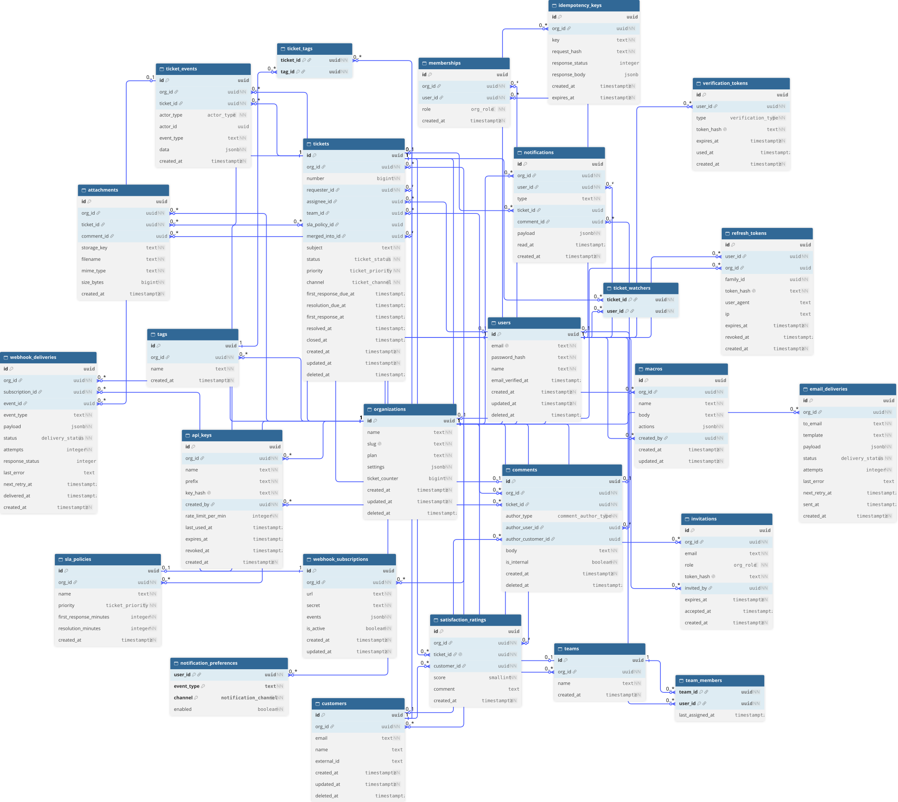

# Gregport

A multi-tenant support ticketing SaaS built with Go and PostgreSQL. It supports organizations, users, memberships, tickets, comments, SLA policies, notifications, and webhooks.

---

## Project Status

| Area | Status |
|:--|:--|
| Authentication | Complete — signup, login, refresh, logout, `/v1/me` |
| JWT and refresh tokens | Complete and tested — refresh rotation, hashing, and reuse detection |
| Tickets | Complete — CRUD, comments, state machine, keyset pagination, optimistic concurrency |
| Teams | Complete — CRUD and membership management |
| Ticket assignment | Complete — manual (assignee or team) and round-robin (auto: true) |
| Tags | Complete — create, list, attach, detach (idempotent) |
| SLA, notifications, webhooks, API keys, invitations | Schema defined, not exposed |
| Watchers | Complete — add/remove (idempotent); assignee and agent commenters auto-watch |
| Timeline | Complete — cursor-paginated ticket_events, oldest first |
| Merge | Complete — source closed and pointed at target; merged tickets read-only |

### Authentication

The authentication implementation includes:

- JWT access tokens.
- Hashed refresh tokens.
- Refresh-token rotation.
- Refresh-token reuse detection.
- Token-family revocation.
- Login, refresh, and logout services.

Every authenticated request carries a verified `user_id`, `org_id`, and `role` in its request context.

### Tickets

The ticket domain is implemented and tested.

- **Create:** Single transaction covering the counter, customer, ticket, comment, and event.
- **List:** Keyset pagination.
- **Get and update:** Optimistic concurrency using `If-Match` and the ticket's `version`.
- **Delete:** Soft deletion, restricted to admins and owners.
- **Comments:** Implemented and exposed.
- **State transitions:** Table-driven state machine.

Tenant isolation is tested across ticket endpoints. Requests for tickets belonging to another organization return `404`, preventing the API from revealing their existence.

The ticket domain currently has **54 tests**.

### Teams and Assignment

Teams support creation, listing, updating, and deletion, along with adding and removing members (admin/owner only).

Ticket assignment supports manual assignment to an individual agent or a team, and round-robin (`auto: true`) within a team.
Round-robin picks the team member with the oldest `last_assigned_at` inside the same transaction, with `SKIP LOCKED` so concurrent assigns do not pick the same agent.

---

## Tech Stack

| Component | Technology |
|:--|:--|
| Language | Go 1.27 |
| Router | [chi](https://github.com/go-chi/chi) |
| Database | PostgreSQL 16 |
| Database environment | Docker Compose |
| PostgreSQL driver | [pgx/v5](https://github.com/jackc/pgx) |
| Authentication | bcrypt, [golang-jwt/jwt/v5](https://github.com/golang-jwt/jwt) |
| IDs | [google/uuid](https://github.com/google/uuid) |
| Env loading | [godotenv](https://github.com/joho/godotenv) |

---

## Architecture

Gregport follows a layered architecture. Each feature lives in its own package under `internal/`, containing its models, repository, service, and handler.

The dependency direction is:

```text
handler → service → repository → database
```

Each layer has a defined responsibility:

- **Handler:** Handles HTTP requests, JSON decoding, and responses.
- **Service:** Contains business logic and remains independent of HTTP and SQL.
- **Repository:** Handles database queries and persistence.
- **Database:** Provides shared database infrastructure, connection pooling, and transactions.

The service layer depends on repository interfaces rather than concrete implementations. This allows tests to inject fake repositories without requiring a database.

### Project Structure

<details>
<summary><code>cmd/api/</code> — application entry point</summary>

- `main.go` — application initialization and entry point.

</details>

<details>
<summary><code>internal/auth/</code> — authentication and tokens</summary>

- `models.go`
- `repo.go`
- `service.go`
- `handler.go`
- `errors.go`
- `tokens.go`
- `repository_tokens_test.go`

</details>

<details>
<summary><code>internal/tickets/</code> — ticket domain</summary>

- `models.go`
- `repository.go`
- `service.go`
- `handler.go`
- `transitions.go`
- `events.go`
- `pagination.go`
- `policy.go`
- `errors.go`
- `repository_test.go`
- `pagination_test.go`
- `update_test.go`
- `transitions_test.go`
- `tenant_test.go`
- `authz_test.go`
- `rollback_test.go`
- `assignment_test.go`
- `teams_test.go`
- `testhelpers_test.go` — shared test helpers, including `seedMembership`, `freshOrg`, and `dropOrg`.

</details>

<details>
<summary><code>internal/middleware/</code> — HTTP middleware</summary>

- `requestid.go`
- `recovery.go`

</details>

<details>
<summary><code>internal/platform/</code> — shared infrastructure</summary>

- `config/` — configuration loading from environment variables.
- `database/` — pgx connection pool and transaction management.
- `httpx/` — `DecodeJSON`, `WriteJSON`, `WriteError`, and `APIError`.
- `requestctx/` — authenticated principal stored in request context.

</details>

<details>
<summary><code>migrations/</code> — database migrations</summary>

- SQL schema and migrations.

</details>

---

## Database Schema



---

---

## API Reference

<details open>
<summary><b>Interactive docs</b></summary>

- **Live (local dev):** [`/swagger/`](http://localhost:8080/swagger/) — start the API, then open this.
- **View spec (Swagger Editor):** [Open `swagger.yaml`](https://editor.swagger.io/?url=https://raw.githubusercontent.com/YOUR_USER/gregport/main/swagger.yaml)

</details>

The OpenAPI spec lives at [`swagger.yaml`](./swagger.yaml).

## Getting Started

### Prerequisites

- Go 1.27
- Docker and Docker Compose
- PostgreSQL 16 (provided through Docker Compose)

### Installation

Clone the repository and enter the project directory.

Copy the example environment file:

```bash
cp .env.example .env
```

Configure the required environment variables, especially `DB_PASSWORD` and `JWT_SECRET`.

Start PostgreSQL:

```bash
docker compose up -d --wait
```

Run the application:

```bash
go run cmd/api/main.go
```

The API listens on port `8080` by default. You can override this using `APP_PORT`.

### Health Check

```bash
curl localhost:8080/healthz
```

Expected responses:

```json
{"status":"ok"}
```

Returned when the database is available.

```json
{"status":"unhealthy"}
```

Returned when the database is unavailable.

---

## Configuration

The application reads its configuration from environment variables.

| Variable | Required | Default | Notes |
|:--|:--:|:--|:--|
| `DB_HOST` | No | `localhost` | PostgreSQL host |
| `DB_PORT` | No | `5432` | PostgreSQL port |
| `DB_USER` | No | `postgres` | Database user |
| `DB_PASSWORD` | Yes | — | Database password |
| `DB_NAME` | No | `gregport` | Database name |
| `APP_PORT` | No | `8080` | HTTP server port |
| `JWT_SECRET` | Yes | — | Minimum 32 bytes |
| `ACCESS_TOKEN_TTL` | No | `15m` | Go duration |
| `REFRESH_TOKEN_TTL` | No | `720h` | Go duration (30 days) |

Generate a secure JWT secret using:

```bash
openssl rand -base64 32
```

`JWT_SECRET` has no default. The application terminates at startup if it is missing or invalid.

Never commit the secret, log it, or reuse it across projects.

---

## API Design and Rules

### Tenant Isolation

Tickets use per-organization numbers rather than UUIDs in their URLs.

The lookup key is `(org_id, number)`. A ticket belonging to another organization returns `404`, never `403`.

This prevents the API from confirming whether a resource exists in another tenant.

### Optimistic Concurrency

Ticket updates require an `If-Match` header.

| Condition | HTTP Status |
|:--|:--|
| Missing `If-Match` header | `428 Precondition Required` |
| Stale ticket version | `412 Precondition Failed` |

Every successful ticket update increments its `version`.

This prevents two agents from silently overwriting each other's changes.

### Ticket Assignment

Assignment is validated within the same transaction as the ticket update.

- The assignee must have an organization membership with the `owner`, `admin`, or `agent` role.
- Team assignment verifies that the team belongs to the caller's organization.
- Client-provided user IDs are never trusted without membership verification.

Assignment also produces a `ticket.assigned` event containing the old and new assignee/team information.

The new assignee is automatically added to `ticket_watchers`. The insertion uses `ON CONFLICT DO NOTHING`, making repeated assignments idempotent.


### Round-robin Assignment

`auto: true` with a `team_id` picks the team member with the oldest `last_assigned_at`.
The pick runs inside the same transaction as the ticket update, with `FOR UPDATE OF team_members SKIP LOCKED`
so concurrent auto-assigns to the same team do not both choose the same agent.
The join on `memberships` excludes agents removed from the org. A team with no assignable members returns 422.

- **Tags are lowercase and unique per org.** `POST /v1/tags` normalizes the
  name (trim, lowercase) before insert; a duplicate in the same org returns
  409. Attach and detach take the tag **name** in the URL, not the UUID, and
  normalize it the same way before the lookup.
- **Tag attach and detach are idempotent.** `ON CONFLICT DO NOTHING` on
  attach, `DELETE` returning zero rows on detach — both return 204 with no
  error. `ticket.tagged` and `ticket.untagged` fire only on an actual
  change; a no-op writes no event.

- **The ticket timeline is append-only and cursor-paginated oldest-first.**
  `GET /v1/tickets/{number}/events` reads `ticket_events` joined to the
  ticket by `(org_id, number)`. Order is `created_at ASC, id ASC` — a
  timeline reads chronologically, unlike the ticket list. Cursor is opaque,
  limit defaults to 50 and caps at 100. No code path issues `UPDATE` or
  `DELETE` on `ticket_events`; the table is an append-only log.
- **Event types and their `data` shapes.** The client switches on
  `event_type`; each type carries a different JSON object in `data`:

- **Merge closes the source and points it at the target.** `POST
  /v1/tickets/{number}/merge` with `{into_number}` runs one transaction that
  locks both rows by id ascending (`FOR UPDATE`, deadlock-safe), checks the
  rules (same org, different tickets, target not closed or already merged,
  same requester), sets `source.merged_into_id = target.id`, closes the
  source, adds a system comment on both tickets, and writes `ticket.merged`
  on the source. A second concurrent merge of the same pair sees the source
  already merged and returns 409.
- **Merged tickets are read-only.** Every mutation — update, assign,
  comment, delete, tag attach/detach — selects `merged_into_id` under
  `FOR UPDATE` and returns 409 if it is set. The check is in the repository,
  next to the lock, so it cannot be bypassed by a caller that skips the
  service.

  | `event_type` | `data` fields |
  |---|---|
  | `ticket.created` | `number`, `subject`, `priority` |
  | `ticket.status_changed` | `old`, `new` |
  | `ticket.assigned` | `old_assignee_id`, `new_assignee_id`, `old_team_id`, `new_team_id`, `auto` (round-robin only) |
  | `ticket.tagged` | `tag` |
  | `ticket.untagged` | `tag` |
  | `comment.added` | `comment_id`, `is_internal` |
  | `ticket.deleted` | — |

### Pagination

Ticket listing uses keyset pagination.

Pass `?limit=N&cursor=<opaque>` to the endpoint.

| Parameter | Description |
|:--|:--|
| `limit` | Page size. Maximum value: `100`. |
| `cursor` | Opaque continuation token returned by the previous response's `next_cursor`. |
| `next_cursor` | Returned by the server. Its absence indicates the last page. |

The ordering is:

```sql
ORDER BY created_at DESC, id DESC
```

The cursor is opaque and should never be parsed by clients.

---

## Testing

The project includes integration tests, authentication unit tests, and security-focused token tests.

### Running Tests

Run the authentication package tests:

```bash
go test ./internal/auth/ -v
```

Run the entire test suite:

```bash
go test ./... -v
```

Ticket tests are integration tests and require PostgreSQL.

### Integration Tests

These tests use a real PostgreSQL database.

**Authentication:**

- Signup transaction rollback.
- Refresh-token rotation and reuse detection.

**Tickets:**

- Concurrent ticket creation: 20 concurrent creates produce ticket numbers `1–20` without gaps or duplicates.
- Failed ticket creation does not leave a gap in per-organization numbering.
- Tenant isolation: every ticket endpoint returns `404` when organization B accesses organization A's ticket.
- Update concurrency: two simultaneous updates result in one successful update and one `412 Precondition Failed`.
- Version mismatch rejection.
- Invalid state transition rejection.
- Valid state transition and event creation.
- Transaction rollback when event creation fails, verified using a forced database trigger.
- Manual assignment to an agent.
- Assignment to a non-member returns `422`.
- Team-only assignment.
- Cross-organization team assignment returns `404`.
- Team creation.
- Duplicate team creation returns `409`.
- Agent team-management attempt returns `403`.
- Adding a cross-organization member returns `422`.
- Tags: create lowercases and trims the name; duplicate per org returns 409;
  attach and detach are idempotent (one event per actual change); attaching
  a nonexistent tag returns 404; attaching a tag to another org's ticket
  returns 404.
- Watchers: add is idempotent; adding a non-member returns 422; remove is
  idempotent; removing a watcher from another org's ticket returns 404; an
  agent who comments is auto-added as a watcher.
- Timeline: events appear in order (created, assigned, tagged, comment,
  status); cursor pagination returns every event exactly once; another
  org's ticket returns 404.
- Merge: happy path closes the source and writes one `ticket.merged` event;
  merge into self returns 422; merging into another org's ticket returns 404;
  two concurrent merges of the same pair yield exactly one success; a comment
  on a merged source returns 409.

### Unit Tests

Authentication unit tests use a fake `Repo` implementation and do not require a database.

- Signup validation and normalization.
- Identical responses for unknown email and incorrect password, using timing-safe dummy bcrypt verification.
- Organization selection:
  - Single organization.
  - Multiple organizations without a slug.
  - Multiple organizations with a slug.
- Refresh-token reuse detection and token-family revocation.
- Unknown tokens do not trigger reuse detection.
- Logout revokes refresh tokens by hash.

The authentication service depends on the `auth.Repo` interface rather than the concrete `*Repository`. Production injects the real repository, while tests inject a fake implementation.

Ticket tests are integration tests and require PostgreSQL.

### Token Tests

These tests perform real JWT signing and verification without a database.

- Access-token round trip.
- Expiry rejection.
- Tamper detection.
- `alg: none` rejection.
- Wrong-secret rejection.
- Refresh-token uniqueness and hashing.

They verify actual security behavior, including algorithm pinning, required expiration, and tamper detection.

### Ticket State Machine Tests

The ticket transition logic is implemented through `CanTransition(from, to)` and tested using a table-driven approach.

- Map-of-maps transition table.
- `closed` is a terminal state.
- 27 table-driven sub-tests, written before implementation using Test-Driven Development (TDD).

### Round-robin assignment

20 concurrent auto-assigns to one team spread across all 3 agents without errors; an empty team returns 422.

### Test Summary

Run `go test ./... -v` and read the output to see the current test results.

The authentication cycle has also been verified end to end using `curl`:

1. Login returns an access and refresh token pair.
2. `/v1/me` accepts a valid access token and rejects unauthenticated requests.
3. Refresh rotates the refresh token.
4. Replaying the previous refresh token returns `401`.
5. Logout returns `204`.
6. Incorrect passwords and unknown emails produce identical `401` responses.

---

## Current Development Direction

round-robin assignment, tags, watchers, the ticket timeline, merge, and macros. Each is a new endpoint on the existing ticket domain, behind the same tenant isolation and role rules.

Future domain work includes exposing the schema-defined functionality: SLA policies, notifications, webhooks, API keys, and invitations.
